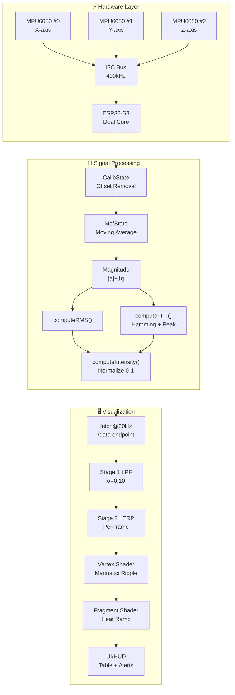
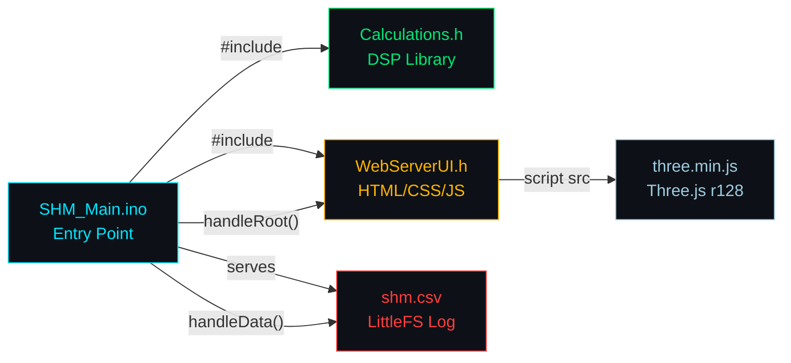
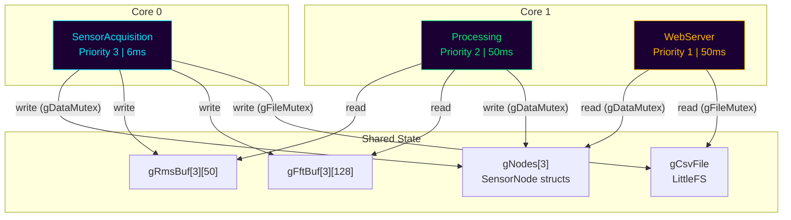
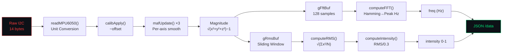
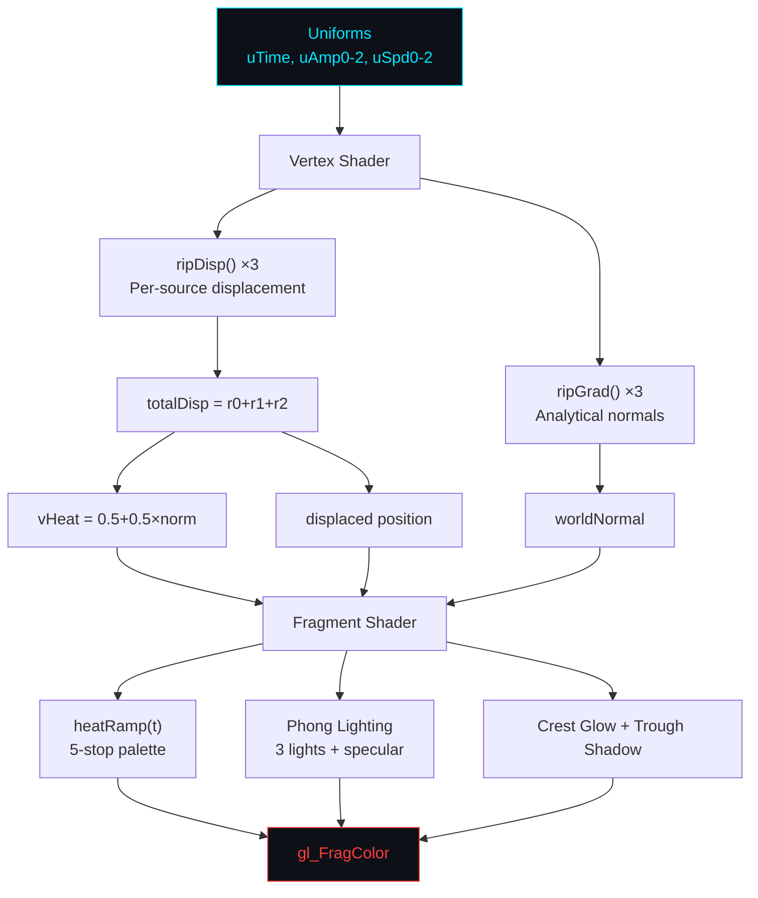
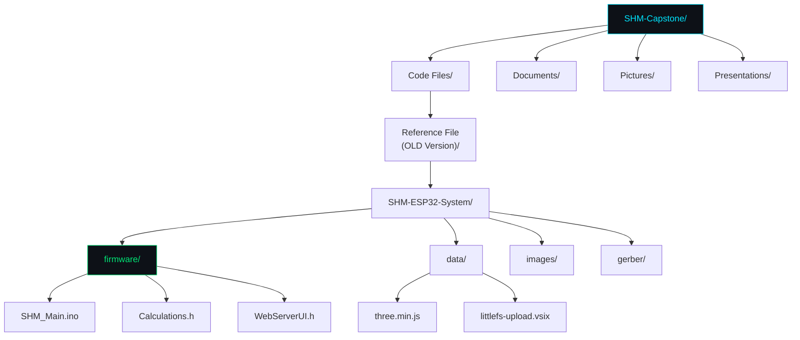

# Graphs — Architecture & Dependency Maps (Graphify)

> Stage 07 | ICM L2 Contract  
> **Input**: Entire codebase structure  
> **Output**: Mermaid diagrams renderable in Obsidian graph view

## 1. System Architecture Graph

## 2. File Dependency Graph

## 3. FreeRTOS Task Interaction Graph

## 4. Signal Processing Pipeline (Detailed)

## 5. Shader Pipeline Graph

## 6. Repository Structure Map

## Links

- [[01-system-overview]] — architecture context
- [[02-signal-processing]] — DSP pipeline detail
- [[03-visualization]] — shader detail
- [[04-firmware]] — task detail
