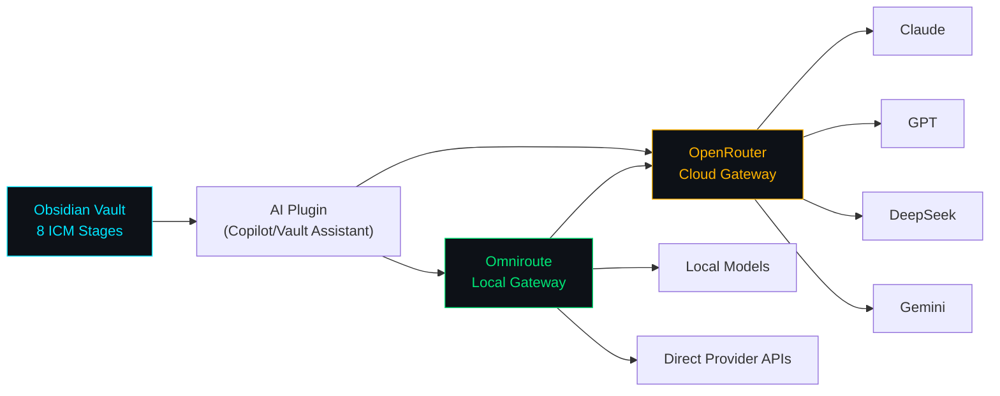

# AI Integration — OpenRouter + Omniroute

> Stage 08 | ICM L2 Contract  
> **Input**: Obsidian vault notes  
> **Output**: AI-queryable knowledge base with multi-provider routing

## Purpose

Enable LLM-powered queries against this vault using:
1. **OpenRouter** — cloud AI API aggregator (multi-model)
2. **Omniroute** — local AI gateway with auto-failover

---

## OpenRouter Configuration

### Setup

1. Create account at [openrouter.ai](https://openrouter.ai)
2. Generate API key at `openrouter.ai/keys`
3. Configure in Obsidian AI plugin (Copilot, Vault Assistant, etc.)

### Obsidian Plugin Settings

```yaml
Provider:  OpenRouter
Base URL:  https://openrouter.ai/api/v1
API Key:   sk-or-v1-xxxxxxxxxxxx  # your key
Model:     anthropic/claude-sonnet-4  # or any model slug
```

### Recommended Models for Vault Queries

| Model | Use Case | Cost |
|-------|----------|------|
| `anthropic/claude-sonnet-4` | Deep code analysis, architecture Q&A | Medium |
| `deepseek/deepseek-chat` | General queries, cost-efficient | Low |
| `google/gemini-2.5-flash` | Fast summaries, quick lookups | Low |
| `meta-llama/llama-3.1-70b-instruct` | Open-source alternative | Free tier |

### API Usage Example (Direct)

```bash
curl https://openrouter.ai/api/v1/chat/completions \
  -H "Authorization: Bearer sk-or-v1-xxxx" \
  -H "Content-Type: application/json" \
  -d '{
    "model": "anthropic/claude-sonnet-4",
    "messages": [
      {"role": "system", "content": "You are an SHM system expert. Use the provided context to answer questions about the Structural Health Monitoring capstone project."},
      {"role": "user", "content": "Explain the signal processing pipeline order and why MAF must run before magnitude."}
    ]
  }'
```

---

## Omniroute Configuration

### Installation

```bash
npm install -g omniroute
omniroute   # starts on http://localhost:20128
```

### Connection Settings

```yaml
Base URL:  http://localhost:20128/v1
API Key:   <generated from local dashboard>
Model:     auto   # Omniroute handles selection + failover
```

### Routing Strategies

| Strategy | When to Use |
|----------|-------------|
| `auto` | Default — smart failover across all providers |
| `cost` | Minimize token costs (vault summarization) |
| `latency` | Fast responses (real-time coding queries) |
| `priority` | Prefer specific models, fallback to others |

### Failover Behaviour

- **429** (rate limit) → automatic re-route to next provider
- **5xx** (server error) → circuit breaker + fallback tier
- **Timeout** → next healthy provider in pool

### Prompt Compression

Omniroute includes built-in compression (RTK/Caveman) that can reduce context tokens by 15–95%. Enable for large vault loads:

```yaml
# In Omniroute dashboard → Settings → Compression
compression: true
compression_strategy: rtk
```

---

## Vault Optimisation for AI (Ponytail Principles)

This vault follows Ponytail's minimalism rules to reduce token consumption:

1. **Each stage ≤ 4K tokens** — fits in bounded context windows
2. **No redundant prose** — tables over paragraphs, formulas over explanations
3. **Flat structure** — no nested sub-stages, one `CONTEXT.md` per topic
4. **Code snippets are minimal** — show signature + key logic only
5. **Cross-references via wikilinks** — load on-demand, not upfront

### Token Budget Estimates

| Stage | Approx Tokens | Content |
|-------|---------------|---------|
| 01 System Overview | ~800 | Architecture + pipeline |
| 02 Signal Processing | ~1,800 | Full DSP chain |
| 03 Visualization | ~1,600 | Shader + smoothing |
| 04 Firmware | ~1,500 | Tasks + I2C + CSV |
| 05 Hardware | ~700 | Wiring + config |
| 06 Documents | ~600 | File index |
| 07 Graphs | ~2,000 | 6 Mermaid diagrams |
| 08 AI Integration | ~1,200 | This file |
| **Total vault** | **~10,200** | Full load (avoid) |

### Recommended Query Patterns

```
# Load only what you need:
"Using context from 02-signal-processing, explain the MAF filter."

# Never load all stages:
"Read the entire vault and summarize."  # ❌ Too many tokens

# Use targeted wikilinks:
"Refer to [[04-firmware]] for the FreeRTOS task structure."
```

---

## Integration Architecture



---

## Links

- [[CLAUDE]] — ICM root router
- [[01-system-overview]] — project context for queries
