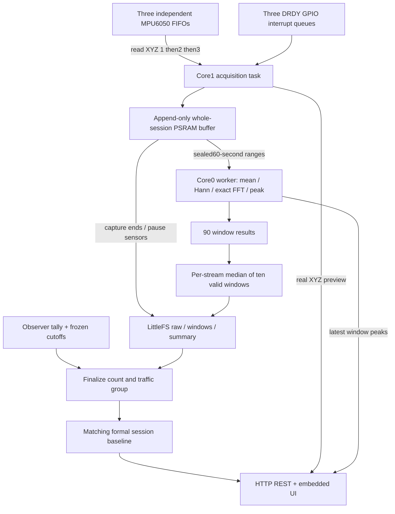

# Firmware data flow

Sampling and web requests do not share an acquisition loop. No disk writes or downloads occur during capture/processing. The worker reads only sealed immutable raw records; append may continue beyond its published end index. At most ten jobs queue. Whole-session memory remains until all jobs and persistence complete.

acquisitionSuspend/resume stops the read task and sensor/FIFO/IRQ stream before idle flash writes and reinitializes before precheck/session use. No capture may span this reset. Each formal session gets its own config snapshot and exact global600s interval. A fresh10s precheck is required after persistence or config changes.

Core1 acquisition priority18; DSP core0 priority1; Arduino loop/web core1 priority1. These are scheduling choices requiring runtime validation with Wi-Fi enabled. Numerical host tests cannot establish queue timing, flash reliability or sensor measurement accuracy.
